# Big Fat Fish Girl for DeepSeek Harness

[](https://github.com/troodon/dsh-big-fat-fish-girl/actions/workflows/ci.yml)
[](LICENSE)
[](https://dsh.pub/en/plugins/?q=troodon%2Fdsh-big-fat-fish-girl)

Big Fat Fish Girl is a desktop pet for DeepSeek Harness. She stays above other apps in a
transparent window while Harness is minimized and follows work across all chats. She shows
current activity, tool use, requests, completion and errors.

Clicking her brings Harness forward on its last-open chat, not a specific session.


## Features

- **Tool activity:** scenes for reading, editing, commands and general work, with distinct
  commentary for browsing and search. Tool names and arguments are not sent to the browser.
- **Requests:** pending requests take priority over other animations.
- **Token usage:** displays provider-reported input and output counts after completion when
  available. It does not estimate costs or balances.
- **Idle behavior:** cursor gaze, hover reactions, random animations, sleep and occasional
  horizontal movement. Each behavior can be disabled in Harness settings.
- **Long runs:** an optional snack animation can appear after 3–5 minutes of continuous work.
- **Languages:** English by default, with Russian and Simplified Chinese available in settings.
- **Character:** DeepSeek Chan (Big Fat Fish Girl) is the only bundled skin.
- **Reduced motion:** uses a stable frame for each state and disables transitions.


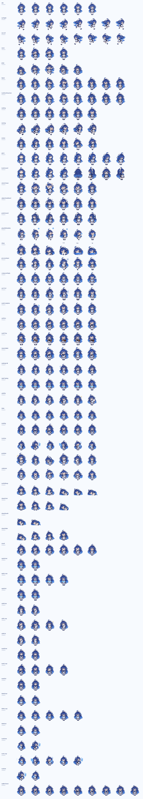

*Generated from every shipped DeepSeek Chan atlas by `node scripts/build-preview.mjs`.*


## Requirements

- DeepSeek Harness **0.2.0-rc.2** (the event contract is verified against it — see
  [docs/HARNESS-CONTRACT-v0.2.0-rc.2.md](docs/HARNESS-CONTRACT-v0.2.0-rc.2.md)).
- A Harness profile with the web interface, such as `web` or `desktop`.
- Runtime dependency: `@deepseek-ai/schemastery`.

## See it move

These captioned loops are rendered from the shipped DeepSeek Chan art by
`node scripts/build-preview.mjs`; the atlas overview above includes every animation sheet.

| | |
| --- | --- |
| 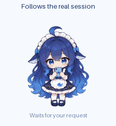 | 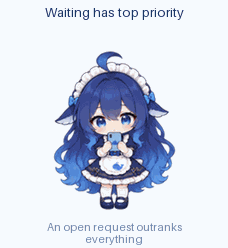 |
| 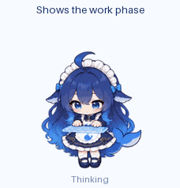 | 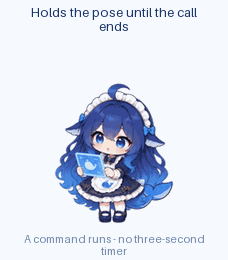 |
| 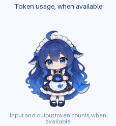 | 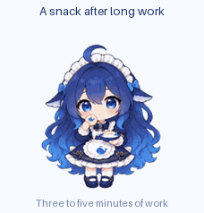 |
| 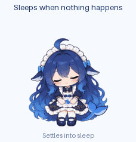 | 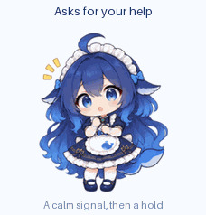 |

## What she says

These samples were captured from the running preview with `npm run preview:lines`.

English — default:

| | | |
| --- | --- | --- |
| 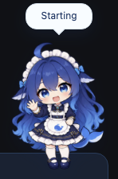 | 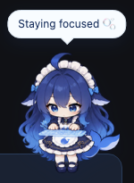 |  |
|  | 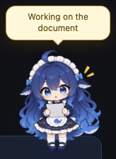 | 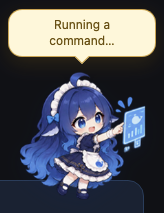 |
|  |  |  |
| 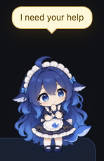 | 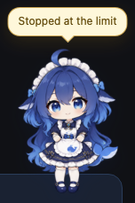 |  |

Russian:

| | | |
| --- | --- | --- |
|  |  |  |
|  |  |  |
| 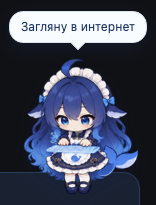 |  | 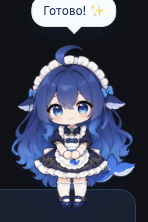 |
|  | 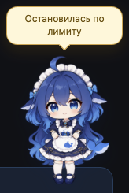 |  |

Simplified Chinese:

| | | |
| --- | --- | --- |
|  |  |  |
|  |  |  |
|  |  |  |
|  | 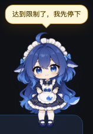 | 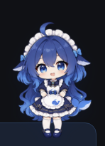 |

The amber bubble is Harness's own approval colour, used when she needs you or is changing
something. A quiet moment has no line at all — the last frame above.

## Install

Download the plugin `.tgz` and the separate macOS app from the same
[GitHub release](https://github.com/troodon/dsh-big-fat-fish-girl/releases). You can also build
the app from that release's source tag.

The plugin package contains runtime code and sprite atlases, without demo GIFs, screenshots,
source art or build tools. Install the `.tgz`, not GitHub's larger **Source code** archive.
Follow the [macOS install guide](https://github.com/troodon/dsh-big-fat-fish-girl/blob/main/docs/INSTALL.md)
for both routes, checksums, Gatekeeper and post-install verification.

## Settings

Settings live in Harness's **Settings** panel, in the **Big Fat Fish Girl** section
(size and opacity are sliders — the pet changes as you drag); the same values are also
editable from the Plugins panel's Configure form. The pet carries no menu or panel of its
own, and the position is the only thing kept per window.

| Setting | What it does |
| --- | --- |
| Size / Opacity | 88–172 px and 0.35–1 |
| Reduce motion | Freezes to each state's readable anchor frame and stops transitions |
| React to hover | On/off for the cursor reactions |
| Random antics | On/off for the spontaneous idle actions |
| Snacks | On/off for the snack after long work |
| Token count display | On/off for provider-reported counts after a completed job |
| Wandering | On/off for the autonomous strolls |
| Language | English by default; Russian and Simplified Chinese are also available |

For state aggregation and priority details, see [docs/ARCHITECTURE.md](docs/ARCHITECTURE.md).

## Desktop shell

For shell startup and bridge details, see [desktop/README.md](desktop/README.md). Build and
platform information is in [desktop/tauri/README.md](desktop/tauri/README.md).

## Development

Node.js 22 or newer is required for development. Install dependencies and run the checks:

```sh
npm install
npm run check
npm run build
npm run build:desktop
node preview/server.mjs
```

`npm run preview:art` regenerates the art previews. Install its pinned Pillow version with
`python3 -m pip install --requirement scripts/preview-requirements.txt`. See [preview/README.md](preview/README.md) for
the local playground, [docs/ARCHITECTURE.md](docs/ARCHITECTURE.md) for the module map, and
[docs/adding-an-animation.md](docs/adding-an-animation.md) to add an animation.

Editable PNGs and original pose boards live on the separate `art-source` branch. Normal builds,
tests and previews use the committed runtime atlases and do not download source art. See the
[art source guide](assets/source/deepseek-chan/README.md) only if you want to rebuild the atlases.

## Known limitations

- The tested macOS desktop build is arm64; Intel is untested.
- Windows builds are untested. Linux builds are not available.
- The pet stays above ordinary windows; full-screen coverage is not promised.
- **Settings are per profile.** Installing the plugin into two profiles gives you two
  independent pets; the pet's window position is the only thing kept per browser window.
- **Token counts are provider-reported or omitted.** The plugin does not estimate money;
  cost, balance and remaining-quota APIs are not part of the verified Harness contract.
- **Other Harness versions are not certified.** The event contract is verified against
  0.2.0-rc.2. The 0.2.1 startup-origin fix does not verify that version's full event contract.

## Privacy

- The plugin makes no outbound requests and sends no telemetry.
- It keeps transient session IDs and status changes in memory. It never reads prompt text,
  responses, tool arguments or session titles.
- For navigation, the plugin sends an opaque ID for the session with an open request or task.
  The ID contains no content, and the host accepts it only while that session is open.
- Provider-reported input and output token counts are summed per task and sent as numbers
  only; model names, message IDs and content are not sent with them.
- Display preferences stay in the Harness profile; only the pet's window position is stored
  in browser local storage.
- See the [verified Harness contract](docs/HARNESS-CONTRACT-v0.2.0-rc.2.md) for event details.

Issues and feature requests: [GitHub Issues](https://github.com/troodon/dsh-big-fat-fish-girl/issues).

## License

Code: [Unlicense](LICENSE), dedicated to the public domain.
Character artwork: not covered by the code dedication; reuse terms are not granted here — see [ASSET_LICENSE.md](ASSET_LICENSE.md).
